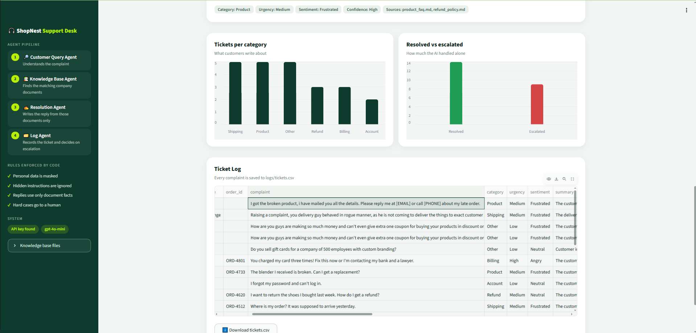
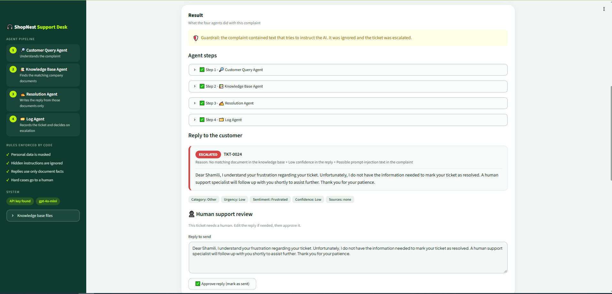

# AI Customer Support Desk (AutoGen + Streamlit)

A multi-agent support desk for a made-up online store, **ShopNest**. A customer complaint goes through
four AutoGen agents. They find the answer in the company's own documents, write a reply, log the ticket,
and hand the difficult cases to a human.

> Social Eagle · Multi-Agent Systems · Buildathon: *AI Customer Support Automation*


## How a complaint flows


```
Streamlit form (complaint, optional name and order ID)
        |
        v   Input guardrails: mask personal data, detect hidden instructions
1. Customer Query Agent   -> category, urgency, sentiment, one-line summary
        |
2. Knowledge Base Agent   -> calls search_kb(), returns passages + the source file name
        |
3. Resolution Agent       -> customer reply using ONLY those passages + a confidence level
        |
4. Log Agent              -> calls log_ticket(): writes one row to logs/tickets.csv, decides Resolved / Escalated
        |
        v
Streamlit shows every agent step, the reply, a green Resolved or red Escalated badge,
a human review box for escalated tickets, the Ticket Log table and a small dashboard
```

The four agents are `AssistantAgent`s in a `RoundRobinGroupChat`, so they always speak in the order above.
The team stops when the Log Agent says `LOGGED` (`TextMentionTermination`), with a 16 message limit
(`MaxMessageTermination`) as a safety net.

## Key idea: the AI writes, plain code enforces

AI output can slip, so everything that must be right is ordinary Python:

| Plain Python (always the same) | AI agents (judgement) |
|---|---|
| Which documents were really used (`kb_sources`) | Understanding the complaint |
| Original complaint saved in the log | Choosing keywords to search |
| Final Resolved / Escalated decision (`escalation.py`) | Writing a polite reply |
| Masking emails, phone and card numbers | Judging confidence |
| Blocking numbers in a reply that are not in the documents | |

## Screenshots

**Ticket raised**


**Escalated ticket with the human review step**


**Ticket Log**


**Dashboard**


**Knowledge base files**


**My own test 1: personal data is masked**



**My own test 2: a hidden instruction is ignored and the ticket is escalated**



## Assignment checklist

| Requirement | Status | Where |
|---|---|---|
| 4 AutoGen agents, one job each | ✅ | `agents/` |
| Round Robin team with a stop condition | ✅ | `team.py` |
| Knowledge base search with a source file name | ✅ | `agents/knowledge_agent.py`, `knowledge_base/` |
| Reply written only from retrieved documents | ✅ | `agents/resolution_agent.py`, number check in `guardrails.py` |
| Ticket logged to CSV | ✅ | `ticket_store.py`, `logs/tickets.csv` |
| Resolved or Escalated decision with a reason | ✅ | `escalation.py` (plain code) |
| Streamlit UI | ✅ | `app.py` |
| 6 test complaints with expected results | ✅ | `examples.py`, `evaluate.py` |
| 2 own test cases | ✅ | `docs/test_cases.md` (cases 7 to 11), screenshots 08 and 09 |
| Screenshots in the README | ✅ | `screenshots/` |

## Bonus challenges

| Bonus | Status | Notes |
|---|---|---|
| Embeddings and a vector store | ✅ | Hybrid search: keyword scoring plus OpenAI embeddings in a FAISS index, merged with rank fusion. If embeddings are unavailable, it falls back to keyword search |
| `SelectorGroupChat` | ➖ | Not used. The fixed order Query, Knowledge, Resolution, Log is enforced with `RoundRobinGroupChat`, which is predictable and easy to audit |
| Human-in-the-loop | ✅ | Escalated tickets show an editable reply and an Approve button. The approval is saved in the log. Built into the UI instead of `UserProxyAgent` |
| Dashboard | ✅ | KPI cards, charts and the ticket log in `app.py` |
| Duplicate-submit protection | ✅ | The same complaint cannot be submitted twice in a row |
| Automated tests | ✅ | 51 `pytest` tests that need no API key |
| Output guardrail and extra escalation rules | ✅ | Unofficial contact details in a reply, bulk enquiries, unofficial payment channels, high-value amounts, requests for a human |
| Deployment | ⏳ | Planned: Docker on a VPS |

## Project structure

```
buildathon-ai-customer-support-desk/
├── app.py                  # Streamlit UI
├── agents/
│   ├── query_agent.py      # Customer Query Agent
│   ├── knowledge_agent.py  # Knowledge Base Agent + search_kb tool
│   ├── resolution_agent.py # Resolution Agent
│   └── log_agent.py        # Log Agent + log_ticket tool
├── team.py                 # wires the agents into one AutoGen team
├── escalation.py           # the escalation rule (plain code)
├── guardrails.py           # input and output guardrails (plain code)
├── ticket_store.py         # reads and writes logs/tickets.csv
├── state.py                # facts about the ticket that is running
├── embeddings.py           # turns text into vectors (OpenAI embeddings, cached)
├── vector_index.py         # FAISS index: finds passages closest in meaning
├── examples.py             # the 6 test complaints from the assignment
├── evaluate.py             # runs the 6 complaints with the real AI
├── tests/                  # 51 fast pytest tests (no API key needed)
├── docs/                   # architecture diagram and test_cases.md
├── pytest.ini
├── knowledge_base/         # 10 short company documents (.md)
├── logs/tickets.csv        # created automatically
├── screenshots/            # UI screenshots used in this README
├── .streamlit/config.toml  # colours and theme
├── .env.example            # OPENAI_API_KEY=your-key-here
├── .gitignore
├── requirements.txt
└── README.md
```

## Setup

Needs Python 3.10 or newer and an OpenAI API key.

**Windows (PowerShell)**
```powershell
python -m venv venv
venv\Scripts\Activate.ps1
pip install -r requirements.txt
copy .env.example .env      # then open .env and put your real key after OPENAI_API_KEY=
```

**macOS / Linux**
```bash
python3 -m venv venv
source venv/bin/activate
pip install -r requirements.txt
cp .env.example .env        # then edit .env and add your key
```

The key is read only from `.env` / the environment. `.env` is in `.gitignore`, so it is never committed.
Optional: set `OPENAI_MODEL` in `.env` (default `gpt-4o-mini`).

## Run

```bash
streamlit run app.py
```

The app opens at http://localhost:8501. Pick a sample complaint from the dropdown (or type your own)
and press **Submit complaint**.

Run all six assignment complaints in one go (adds six tickets to the log):
```bash
python evaluate.py
```

## The knowledge base

Ten short documents for ShopNest in `knowledge_base/`:

| Document | Covers |
|---|---|
| `shipping_policy.md` | delivery times, charges, tracking, delayed and lost parcels |
| `refund_policy.md` | return window, refund timelines, exchanges |
| `account_and_login.md` | sign-in, password reset, account changes |
| `product_faq.md` | warranty, defective items, sizes, availability |
| `payments_and_billing.md` | payment methods, COD, double charges, coupons |
| `offers_and_rewards.md` | coupons, wallet cashback, first-order offer, sale prices |
| `order_management.md` | cancelling and changing orders, undelivered and missing items |
| `support_and_contact.md` | support hours, response times, feedback |
| `security_and_scams.md` | official channels, OTP safety, fraudulent charges |
| `app_and_website_help.md` | app crashes, checkout not loading, notifications, address settings |

They contain real-looking details (delivery times, a 14 day return window, password reset steps)
so every answer can be checked against the file.


## Hybrid search

`search_kb` combines two ways of finding the right passage:

| Method | Good at | Example |
|---|---|---|
| Keyword scoring (stemming, synonyms, IDF) | exact words | "refund", "password" |
| Embeddings and FAISS (`embeddings.py`, `vector_index.py`) | same meaning, different words | "my parcel never showed up" finds the delayed-orders passage |

The two result lists are merged with Reciprocal Rank Fusion. Passages whose meaning-similarity is
below `VECTOR_MIN_SCORE` (in `config.py`) are ignored, so an unrelated question still gives NO_MATCH.
Vectors are cached in `.cache/`, so documents are embedded only when they change.

## Escalation rule

A ticket is **Escalated** to a human when any of these is true:

1. urgency is High
2. the customer is very angry
3. the Knowledge Agent found no matching document
4. the complaint mentions a legal threat, fraud or a payment dispute
5. the Resolution Agent's confidence is Low
6. the reply uses numbers (days, prices) that are not in the retrieved documents (guardrail)
7. the complaint looks like a prompt-injection attempt (guardrail)
8. the reply contains an email, web link or phone number that is not official (guardrail)
9. the complaint is a bulk or business enquiry (for example "500 employees")
10. the customer paid or ordered through an unofficial website or channel (Instagram, WhatsApp and so on)
11. the complaint mentions an amount of Rs 10,000 or more
12. the customer asks to speak to a human, a manager or a supervisor

The reason is written to `escalation_reason` in the log and shown in the UI.

## Guardrails and human-in-the-loop

- **Personal data is masked** (email, phone, card and ID numbers) before the AI sees the complaint and before it is logged.
- **Hidden instructions are ignored.** Text such as "ignore all previous instructions" is detected, the agents are warned, and the ticket is escalated.
- **No invented policies.** Numbers in the reply must appear in the retrieved passages or the complaint, or the ticket is escalated.
- **No unofficial contact details.** If the reply contains an email, web link or phone number that is not ShopNest's (or not in the retrieved documents), the ticket is escalated. This stops a made-up support address from reaching a customer.
- **Human review.** For an Escalated ticket the UI shows an editable reply and an **Approve reply (mark as sent)** button.
  The approval and the final text are saved in the log (`human_review`, `human_reply`). Nothing is actually emailed; the
  approve step is where a real email or WhatsApp call would go.

## Log file format

`logs/tickets.csv` (opens in Excel) has one row per ticket:

`ticket_id, timestamp, customer_name, order_id, complaint, category, urgency, sentiment, summary, kb_sources, response, confidence, status, escalation_reason, human_review, human_reply`

## Test results (`python evaluate.py`, model gpt-4o-mini)

| # | Complaint | Result |
|---|---|---|
| 1 | Where is my order? It was supposed to arrive yesterday. | Shipping, **Resolved**, from the shipping policy |
| 2 | I want to return the shoes I bought last week. How do I get a refund? | Refund, **Resolved**, from the refund policy |
| 3 | I forgot my password and can't log in. | Account, **Resolved**, reset steps |
| 4 | The blender I received is broken. Can I get a replacement? | Product, **Resolved**, replacement process |
| 5 | You charged my card three times! Fix this now or I'm contacting my bank and a lawyer. | Billing, High, Angry, **Escalated** (3 reasons) |
| 6 | Do you sell gift cards for a company of 500 employees with custom branding? | **Escalated**: no matching document, low confidence and a bulk enquiry, so a human follows up |

All six tickets got the expected status.

Fast offline tests: run `pytest` (51 tests, about 1 second, no API key needed).
All test cases are listed in [docs/test_cases.md](docs/test_cases.md).

## What I learned

- A plain-code rule is safer than asking the AI to "remember" a rule: even if the AI marks a ticket as not urgent, the escalation code still escalates a legal threat.
- Testing with a fixed set of complaints and written expectations found a wrong test case quickly.
- A second safety layer matters: for the gift card complaint the search found a loosely related passage, and the Resolution Agent's Low confidence still sent it to a human.

## Notes and limits

- The company, policies and prices are invented for this assignment.
- Search is hybrid (keywords and embeddings). It is tuned for a small knowledge base of 10 documents.
- The human review step is an approve button in the UI, not AutoGen's `UserProxyAgent`.
- Keep your API key out of screenshots and posts. If a key was ever pushed to GitHub, revoke it and create a new one.